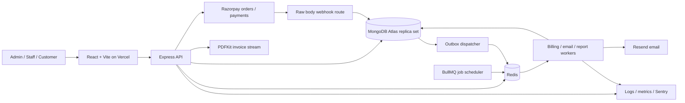
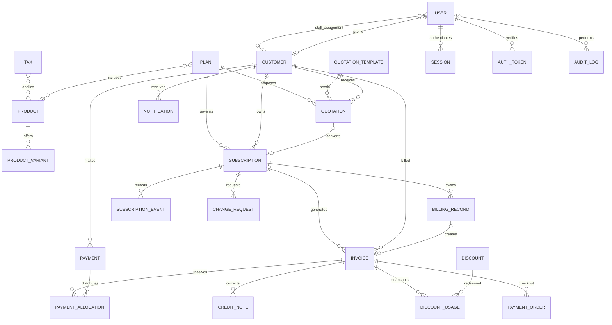

# SubscriptIQ — Phase 1 design for approval

Company: Brightloop Software. Status: planning complete against pasted brief; implementation not started. Date: 31 October 2026.

## 1. Requirements and source boundary

The supplied master prompt is the available requirements source. The referenced Subscription Management System PDF was not attached: its contents have not been analyzed. PDF reconciliation remains an acceptance gate before claiming full requirements coverage. The decisions marked proposed below require business confirmation; they are not inferred PDF requirements.

### Functional requirements and acceptance evidence

| ID   | Requirement                                                                                                                                   | Required evidence / phase                                                                             |
| ---- | --------------------------------------------------------------------------------------------------------------------------------------------- | ----------------------------------------------------------------------------------------------------- |
| FR01 | Registration, login/logout, verification, password recovery, rotating refresh sessions, role and ownership authorization                      | Duplicate normalized email rejected; invalid login throttled; expired/reused tokens rejected; phase 3 |
| FR02 | Admin staff creation and permissions; staff customer assignment; customer profile isolation                                                   | Negative permission matrix tests, including guessed IDs; phases 3, 12                                 |
| FR03 | Products, type, description, sales/cost prices, notes, archive, search, variants and additional price                                         | Server-priced line calculations and archived selection rejection; phase 4                             |
| FR04 | Daily/weekly/monthly/yearly plans, linked products, price, minimum quantity, availability, auto-close and action permissions                  | Boundary date and minimum quantity tests; phase 5                                                     |
| FR05 | Templates, numbered quotations, editable drafts, expiry, email, acceptance/rejection and one-time conversion                                  | Expiry race and duplicate conversion tests; phase 6                                                   |
| FR06 | Numbered subscriptions, snapshot lines, dates, terms, complete lifecycle, pause/resume, renew, cancel, close, upgrades/downgrades and history | Transition and concurrent mutation tests; phase 7                                                     |
| FR07 | Effective product taxes and fixed/percentage discounts with purchase/quantity/date/product/redemption constraints                             | Exact rounding, expiration and concurrent final redemption tests; phase 8                             |
| FR08 | Snapshot invoices, due dates, confirm/cancel, search, history, print/PDF, immutable finalization and credit adjustments                       | Snapshot immutability and correction reconciliation; phase 9                                          |
| FR09 | Autonomous recurring billing, cycle deduplication, transactions, retries, failed-job inspection/recovery and logs                             | Multiple workers/crash replay produce one invoice per cycle; phase 10                                 |
| FR10 | Razorpay orders, server verification, signed idempotent webhooks, manual/partial/multiple payments, allocations and balances                  | Wrong signature/order/amount/customer rejected; concurrent allocation tests; phase 11                 |
| FR11 | Customer overview, catalog, subscriptions, invoices/PDF/payments/profile and lifecycle requests                                               | Browser flows and cross-customer isolation; phase 12                                                  |
| FR12 | Financial metrics, eight chart families, all required date filters, product/plan reporting and exports                                        | Fixed ledger fixtures independently reconcile totals; phase 13                                        |
| FR13 | All required email events, retries and delivery logs; audit trails; system settings                                                           | Provider failure/replay tests, secret redaction and admin access checks; phase 14                     |
| FR14 | Responsive admin/staff/customer layouts, working navigation/forms/filters, accessible states                                                  | Keyboard, responsive, loading/empty/error and complete browser flows; phases 2–15                     |
| FR15 | OpenAPI, Docker, CI, deployment guides, health checks, logging, Sentry and load tests                                                         | Clean setup, CI gates and measured release report; phase 15                                           |

### Non-functional requirements

- Financial correctness: INR paise persisted as safe integers; BigInt intermediate calculations; bounded inputs; percentage rates in integer basis points. Never perform decimal-money multiplication with JavaScript floating point. Round half-up once per line component using integer division. Reject results outside safe persisted bounds.
- Security: Argon2id hashes; password length at least 9 with uppercase, lowercase and special character; normalized unique email; short-lived access JWT held in memory; hashed rotating opaque refresh tokens in Secure HttpOnly cookies; restricted CORS, CSRF/origin protection for cookie-authenticated endpoints, secure headers, rate limits and Zod validation. No secrets in frontend or logs.
- Reliability: MongoDB is authoritative; queues deliver at least once; critical writes use transactions, unique constraints and compare-and-set state/version checks. External delivery uses a transactional outbox.
- Performance: proposed acceptance workload is 10,000 subscriptions, 100 concurrent interactive users and a 1,000-cycle due burst. Target p95 normal API and dashboard response below two seconds on documented infrastructure, with no duplicate cycles or dropped jobs. Ratify workload before release; no performance claim until k6 measurement.
- Operability: structured correlated logs, sanitized Sentry errors, readiness/liveness, queue lag/failure metrics, backup/restore rehearsal, graceful worker shutdown, incident and recovery runbooks.
- Accessibility: proposed WCAG 2.2 AA target, keyboard operation, labeled inputs/errors, visible focus, sufficient contrast, reduced motion and responsive tables.
- Data: pagination, allowlisted filters/sorts, immutable financial snapshots, bounded queries, UTC instants plus IANA billing timezone. Retention and backup recovery targets require agreement.

## 2. Architecture

Use a TypeScript workspace and modular monolith, deployed as separate web, API and worker processes. Shared contracts provide Zod request/response types; pure domain code owns arithmetic, transitions and calendar rules. Mongoose models remain server-only. Controllers translate HTTP; services enforce authorization and transactions; repositories encapsulate queries. This keeps financial rules identical in API and workers without creating distributed services prematurely.



Web uses React Router for protected role layouts, TanStack Query for server state, Redux Toolkit only for session/UI state, Axios with a single refresh flow, React Hook Form + Zod, Tailwind + shadcn/ui, Lucide, Sonner and Recharts. Do not duplicate server datasets into Redux. No Passport dependency unless a real provider strategy is added.

Expose custom same-site web/API domains where possible. If hosting requires cross-site cookies, explicitly configure SameSite=None + Secure, credentials, origin allowlist and CSRF defenses. Production secrets belong in platform secret stores; Vite variables are public.

MongoDB transactions require a replica set or supported sharded deployment; local Compose must initialize a single-node replica set. [MongoDB production considerations](https://www.mongodb.com/docs/manual/core/transactions-production-consideration/).

BullMQ jobs must be idempotent, including after worker crashes. Use the supported Job Scheduler API when dependencies are selected, rather than legacy repeatable APIs. [Idempotent jobs](https://docs.bullmq.io/patterns/idempotent-jobs), [Job schedulers](https://docs.bullmq.io/guide/job-schedulers/).

Resolve current stable compatible dependency versions in phase 2, verify Node engine compatibility, commit the lockfile and use reproducible installs. No package versions are asserted by this planning document.

## 3. Data model

All collections use ObjectId identifiers and createdAt/updatedAt unless append-only. Foreign references must be validated in services: MongoDB references do not enforce relational integrity. Financial records are never cascade-deleted. Mutable records use optimistic version checks.

| Collection        | Fields and relationships                                                                                                                                                                                                           | Principal indexes                                                                        |
| ----------------- | ---------------------------------------------------------------------------------------------------------------------------------------------------------------------------------------------------------------------------------- | ---------------------------------------------------------------------------------------- |
| User              | emailNormalized, passwordHash, role, permission grants, active, verifiedAt, customerId?                                                                                                                                            | unique emailNormalized; role/active                                                      |
| Customer          | userId?, displayName, company, billing address, contact, tax identifiers, assignedStaffIds[], status                                                                                                                               | unique partial userId; assignedStaffIds/status; searchable name                          |
| Product           | name, type, description, salesPriceMinor, costPriceMinor, notes, status                                                                                                                                                            | status/name                                                                              |
| ProductVariant    | productId, name, additionalPriceMinor, status                                                                                                                                                                                      | unique productId/name                                                                    |
| Plan              | name, description, product configurations, explicit price policy, frequency, minQuantity, availableFrom/Until, autoClose, allowPause/EarlyClosure/Renewal, status, version                                                         | status/availableFrom/availableUntil                                                      |
| QuotationTemplate | name, reusable product/plan lines, terms, active                                                                                                                                                                                   | active/name                                                                              |
| Quotation         | number, customerId, templateId?, planId, expiryAt, line snapshots, totals, terms, status, convertedSubscriptionId?                                                                                                                 | unique number; customerId/status/expiryAt                                                |
| Subscription      | number, customerId, planId, planVersion snapshot, sourceQuotationId?, startAt, expiryAt?, billingTimezone, originalAnchor, frequency, termsDays, priced line snapshots, totals, nextBillingAt, status, version, pause data         | unique number; unique partial sourceQuotationId; status/nextBillingAt; customerId/status |
| Tax               | name, rateBps, type, productIds[], effectiveFrom/Until?, active                                                                                                                                                                    | active/effectiveFrom; productIds                                                         |
| Discount          | code/name, fixedMinor or percentBps, minPurchaseMinor, minQuantity, start/end, maxRedemptions?, usedCount, scope, productIds[], active                                                                                             | unique code if provided; active/start/end                                                |
| DiscountUsage     | discountId, invoiceId, subscriptionId, amountMinor, redemptionKey                                                                                                                                                                  | unique redemptionKey; discountId/invoiceId                                               |
| Invoice           | number, customerId, subscriptionId, billingRecordId?, customer snapshot, issuedAt, dueAt, currency, line/price/tax/discount snapshots, subtotal/discount/tax/totalMinor, paidMinor, creditedMinor, lifecycleStatus, balance status | unique number; unique partial billingRecordId; customerId/dueAt; lifecycleStatus/dueAt   |
| Payment           | customerId, invoice intent?, provider, providerPaymentId?, orderId?, amountMinor, currency, method, reference, paidAt, status, notes, idempotencyKey                                                                               | unique partial provider/providerPaymentId; unique idempotencyKey; customerId/paidAt      |
| PaymentAllocation | paymentId, invoiceId, amountMinor, reversal reference?                                                                                                                                                                             | paymentId/invoiceId; invoiceId                                                           |
| BillingRecord     | subscriptionId, cycleStart/End, cycleKey, invoiceId, status, attempts, lastError, completedAt                                                                                                                                      | unique subscriptionId/cycleStart; unique cycleKey; status/updatedAt                      |
| Notification      | user/customer recipient, eventKey, type, payload reference, status, providerMessageId, attempts, sentAt, error                                                                                                                     | unique eventKey; status/createdAt                                                        |
| AuditLog          | actorId, role, action, resourceType/id, redacted before/after, timestamp, IP, correlationId                                                                                                                                        | resourceType/resourceId/timestamp; actorId/timestamp                                     |

Additional collections are necessary to make the requested behavior reliable; these extend the required 17 rather than replace them:

| Collection        | Purpose and indexes                                                                                                                        |
| ----------------- | ------------------------------------------------------------------------------------------------------------------------------------------ |
| Session           | Hashed refresh tokens, family, expiry/revocation; unique token hash, TTL expiry                                                            |
| AuthToken         | Hashed one-time verification/reset tokens; unique hash and TTL expiry; explicit expiry checks despite asynchronous TTL deletion            |
| OutboxEvent       | Transactional delivery intent, event type, resource, dedup key, lease, attempts, dispatch state; unique dedup key and status/nextAttemptAt |
| WebhookEvent      | Provider event identity, payload hash, sanitized payload/reference, durable processing state; unique provider/eventId                      |
| PaymentOrder      | Customer/invoice/amount/currency binding, provider order ID, reservation expiry; unique providerOrderId and request key                    |
| CreditNote        | Numbered immutable invoice corrections, line snapshots and totals; unique number, invoiceId                                                |
| SubscriptionEvent | Append-only lifecycle history with actor/reason/effectiveAt; subscriptionId/effectiveAt                                                    |
| ChangeRequest     | Customer cancellation/plan change request, proposed plan, status, approval actor/effectiveAt; customerId/status, subscriptionId/status     |
| SystemSetting     | Validated business configuration, timezone, numbering, terms; unique key; no raw provider secrets                                          |
| Sequence          | Atomic numbering counters; unique scope/year/type                                                                                          |
| ExportJob         | Scoped report request, filters, status, expiring private artifact reference; requestedBy/createdAt                                         |

Invoice and quotation embedded lines include product/variant IDs, names, quantity, unit price, base amount, discount identity/value, taxable amount, tax identity/rate/type/amount and final amount. Invoice customer details and payment terms are snapshots. Plans store product configurations; subscriptions snapshot the approved pricing and permission version so later edits cannot silently change contracts.



OutboxEvent and AuditLog refer polymorphically to domain resources. WebhookEvent links provider events to PaymentOrder/Payment by provider identifiers. ER many-to-many associations are ID arrays or embedded plan configurations, except payment allocations and discount usage which have explicit collections.

## 4. Permissions

| Capability                                                               | Admin                        | Staff                                        | Customer                                                                |
| ------------------------------------------------------------------------ | ---------------------------- | -------------------------------------------- | ----------------------------------------------------------------------- |
| Staff accounts, permission grants, settings, audit, taxes/discount rules | Full                         | Denied                                       | Denied                                                                  |
| Product/variant/plan/template configuration                              | Full                         | Read active permitted catalog/templates      | Read public active catalog/plans                                        |
| Customer information                                                     | All                          | Assigned customers with grants               | Own profile allowlisted fields                                          |
| Quotes                                                                   | All                          | Assigned customer, granted operations        | Own read/accept/reject                                                  |
| Subscriptions                                                            | All valid operations         | Assigned customer and per-operation grant    | Own view; request cancel/plan change; pause/resume only if plan permits |
| Invoices/PDF/notifications                                               | All valid operations         | Assigned customer with grants                | Own read/download/pay                                                   |
| Payments                                                                 | All, including manual record | Assigned customer, manual grant              | Own online checkout/history                                             |
| Analytics/export                                                         | All                          | Granted reports scoped to assigned customers | Own summary only                                                        |
| Failed jobs/recovery/credit notes                                        | Admin                        | Denied by default                            | Denied                                                                  |

Authorization combines role + action grant + resource ownership/assignment + state/plan policy in service methods. Scope listing, aggregates, exports and downloads at query time. Never trust customerId, role, unit price, tax or totals sent by a customer. Return 404 for inaccessible resource identifiers. A role guard alone is insufficient.

## 5. API contract inventory

Base `/api`; JSON response `{ data, meta? }`, error `{ error: { code, message, fieldErrors?, requestId } }`. Use 201 for creation, 202 for async jobs, 204 for deletion/logout, 400/422 validation, 401 authentication, 403 denied operation, 404 inaccessible resource, 409 conflicts, 429 throttling. Dates ISO 8601; money integer minor units with currency. Lists accept bounded `page`, `pageSize` (maximum 100), allowlisted `sort`, `q` and resource-specific filters. UTC half-open date ranges `[from,to)`.

| Resource          | Endpoints                                                                                                                                                                                                                                                      |
| ----------------- | -------------------------------------------------------------------------------------------------------------------------------------------------------------------------------------------------------------------------------------------------------------- |
| Auth              | POST `/auth/register`, `/auth/login`, `/auth/logout`, `/auth/refresh`, `/auth/verify-email`, `/auth/resend-verification`, `/auth/forgot-password`, `/auth/reset-password`; GET `/auth/me`; POST `/auth/logout-all`                                             |
| Profile           | GET/PATCH `/me`; GET `/me/sessions`; DELETE `/me/sessions/:id`                                                                                                                                                                                                 |
| Staff             | GET/POST `/staff`; GET/PATCH `/staff/:id`; PATCH `/staff/:id/permissions`; POST `/staff/:id/deactivate`                                                                                                                                                        |
| Customers         | GET/POST `/customers`; GET/PATCH `/customers/:id`; PATCH `/customers/:id/assignments`                                                                                                                                                                          |
| Products          | GET/POST `/products`; GET/PATCH/DELETE `/products/:id` (DELETE archives); GET/POST `/products/:id/variants`; PATCH/DELETE `/products/:id/variants/:variantId`                                                                                                  |
| Plans             | GET/POST `/plans`; GET/PATCH/DELETE `/plans/:id`; POST `/plans/:id/activate`, `/plans/:id/deactivate`                                                                                                                                                          |
| Templates         | GET/POST `/quotation-templates`; GET/PATCH/DELETE `/quotation-templates/:id`                                                                                                                                                                                   |
| Quotations        | GET/POST `/quotations`; GET/PATCH `/quotations/:id`; POST `/quotations/:id/send`, `/accept`, `/reject`, `/convert`                                                                                                                                             |
| Subscriptions     | GET/POST `/subscriptions`; GET/PATCH `/subscriptions/:id` (draft only); POST `/subscriptions/:id/quote`, `/confirm`, `/activate`, `/pause`, `/resume`, `/renew`, `/cancel`, `/close`, `/upgrade`, `/downgrade`; GET `/subscriptions/:id/history`               |
| Customer requests | GET/POST `/subscriptions/:id/change-requests`; GET `/change-requests`; POST `/change-requests/:id/approve`, `/reject`                                                                                                                                          |
| Taxes             | GET/POST `/taxes`; GET/PATCH `/taxes/:id`; POST `/taxes/:id/deactivate`                                                                                                                                                                                        |
| Discounts         | GET/POST `/discounts`; GET/PATCH `/discounts/:id`; GET `/discounts/:id/usage`; POST `/discounts/:id/deactivate`                                                                                                                                                |
| Invoices          | GET `/invoices`; GET `/invoices/:id`; POST `/subscriptions/:id/invoices` (idempotent authorized generation); POST `/invoices/:id/confirm`, `/cancel`, `/send`; GET `/invoices/:id/pdf`, `/history`; POST `/invoices/:id/credit-notes`; GET `/credit-notes/:id` |
| Payments          | GET/POST `/payments` (POST manual); GET `/payments/:id`; POST `/payments/create-order`, `/payments/verify`; GET `/invoices/:id/payments`; POST `/webhooks/razorpay` (raw body, no JWT)                                                                         |
| Analytics         | GET `/analytics/dashboard`, `/revenue`, `/subscriptions`, `/payments`, `/customers`, `/outstanding`; date filters and product/plan groupings                                                                                                                   |
| Reports           | POST `/reports/exports`; GET `/reports/exports`, `/reports/exports/:id`; GET `/reports/exports/:id/download`                                                                                                                                                   |
| Operations        | GET `/audit-logs`, `/notifications`, `/billing-records`, `/jobs/failed`; POST `/notifications/:id/retry`, `/jobs/:queue/:id/retry`; GET/PATCH `/settings`                                                                                                      |
| Infrastructure    | GET `/health/live`, `/health/ready`, `/openapi.json`, `/docs` (production access policy configurable)                                                                                                                                                          |

Suffixes such as `/accept` in a row inherit that row's resource prefix. Each route requires explicit Zod schemas, documented scopes, success/errors, pagination and examples in OpenAPI during its phase. This is the complete planned inventory, not a claim that a machine-readable specification or endpoints already exist. Mutating financial commands require an Idempotency-Key scoped to actor/action with request-body hash; same key/different payload returns 409. PATCH uses a version precondition.

## 6. Critical domain workflows

### Lifecycle and approvals

Proposed persisted states: draft → quotation → confirmed → active → closed, with paused and cancelled as explicit additional states. Quotation acceptance/conversion creates one confirmed subscription; direct staff-created drafts require confirmation before activation. Only draft lines are editable. Activation establishes the first cycle. Terminal closed/cancelled states do not reactivate through generic PATCH.

Active → paused requires plan permission and audit reason. Paused → active resets scheduling according to the approved pause policy. Renew requires renewal permission and an eligible expiry state; closed renewal creates a linked successor rather than rewriting history. Early close requires plan permission and an explicit effective date. Customer cancellation and plan changes create requests; staff/admin grant approval according to permissions. Upgrade/downgrade must compare normalized recurring value and be scheduled as a versioned contract change.

Proposed business defaults for approval: billing in advance; first invoice on activation; cancellation and plan changes at period end; no mid-cycle proration initially; pause takes effect at the next unbilled boundary and freezes future billing; existing debt remains due. Immediate changes/credits require an explicit adjustment, never silent invoice mutation. No automatic suspension for nonpayment unless a grace/dunning policy is approved. These policies need confirmation before phase 7.

### Pricing, tax and discount rules

One pricing policy per plan: explicit plan line price or product base plus variant delta. Never add both a plan override and base price accidentally. Example product 100000 paise + variant delta 56000 = 156000 per unit. Determine whether the brief's variant examples are absolute or additional prices before phase 4; proposed UI stores a clearly labeled delta and displays the resulting unit price.

Require positive integer quantity meeting plan minimums; nonnegative bounded prices; plan availability checked on quotation conversion and activation. Invoice prices come from the approved subscription snapshot; currently effective taxes/eligible discounts are resolved for the billing date and copied permanently into the invoice. Proposed tax policy is exclusive tax on discounted line amounts, no compounding. Inclusive taxes, tax-type jurisdiction rules and statutory invoice fields need explicit requirements.

Proposed discount default: one best eligible rule per line, no stacking; subscription-wide fixed discounts allocated proportionally with deterministic largest-remainder handling. Consumption occurs once at invoice confirmation in the billing transaction. Max usage uses a conditional atomic counter and unique usage key; cancelled invoices do not automatically restore redemptions. Effective dates have explicit timezone and exclusive end semantics.

### Billing atomicity and recovery

1. Scheduler scans indexed active/due subscriptions in bounded pages; each cycle uses a stable subscription ID + cycle start key. Queue job IDs are an optimization, not the correctness boundary.
2. Worker opens a transaction, reloads subscription/version, validates state, dates and expiry, and inserts the uniquely keyed BillingRecord.
3. Resolve prices/discounts/taxes, reserve usage conditionally, insert the uniquely linked invoice and audit/history records, then advance nextBillingAt using the original calendar anchor with a version check.
4. Insert notification/outbox intent and commit. Unique-key conflict or transaction contention retries/readbacks resolve to the already committed invoice. MongoDB transaction callback must contain no external side effects.
5. Outbox dispatcher leases durable intents and enqueues delivery. Crash after enqueue/before acknowledgment can repeat dispatch; consumers deduplicate using event keys. Record provider delivery state; external email cannot be promised exactly once across every network failure.
6. Exponential backoff with jitter and bounded attempts; failed jobs remain inspectable. Admin retry keeps the original cycle key and logs the recovery action. Scanner catches missed cycles after downtime in bounded catch-up batches; no silent cycle skipping.

Persist original day/month anchor. Jan 31 monthly becomes Feb 28/29 then Mar 31; Feb 29 yearly clamps in nonleap years and returns to Feb 29 in leap years. Compute calendar recurrence in the subscription's IANA timezone, then persist UTC. Define DST gap/overlap resolution deterministically. Daily means local calendar day, not universally 24 elapsed hours. Reject billing beyond expiry; test start/expiry equal boundaries and auto-close races. Cancellation/pause and billing contend on the same subscription version so ordering has a clear winner.

### Invoice and payment integrity

Separate invoice lifecycle (draft/confirmed/cancelled) from computed balance status (unpaid/partial/paid/overdue), exposing requested UI labels consistently. Finalized content is immutable. Only unsettled eligible invoices can be cancelled; settled corrections require credit notes and, if funds must return, a separately approved refund workflow. Cancel/credit cannot manufacture negative outstanding balances.

Create Razorpay orders on the server against an owned payable invoice and amount. A valid checkout signature alone does not imply captured funds: verify provider payment/order binding, currency, amount and captured status. Raw-body webhook signature validation precedes JSON parsing. Durably store event receipts and process idempotently; handle duplicates and out-of-order events. Provider payment identity is unique across both verification and webhook paths.

In a transaction, post a captured/manual payment once, allocate positive amounts without exceeding either unallocated payment funds or invoice balance, update reconciliation and emit audit/outbox events. Failed/authorized payments allocate nothing. Concurrent browser payments may both capture externally; persist any surplus as unallocated customer credit for review rather than dropping the money or overallocating. Manual entries require a unique request key, reference and authorized actor. Background reconciliation queries uncertain provider results after timeouts. Existing invoices remain payable after subscription cancellation.

Automated invoicing and automated charging are distinct: the requested Razorpay order checkout collects customer-initiated payments. Unattended recurring debit requires mandates and a supported Razorpay subscription/autopay integration, which must be explicitly scoped before promising automatic collection.

## 7. Analytics definitions

- Cash collected: captured/manual settled payments by paidAt, with refunds represented separately and net cash explicitly labeled.
- Invoiced revenue: confirmed invoice net-of-credit values by invoice date; exclude cancelled/draft invoices; show tax separately from revenue.
- MRR: active recurring pre-tax contractual value after recurring discounts, normalized monthly; proposed weekly × 52/12, daily × 365/12, monthly × 1, yearly ÷ 12 using rational integer arithmetic and final display rounding. Exclude paused contracts and one-time charges. This is an operating metric, not recognized accounting revenue.
- ARR = 12 × unrounded MRR. Collected cash and invoices must not be labeled MRR.
- Outstanding = confirmed total less valid credits and allocated settled payments; overdue means positive balance and dueAt before the reporting instant.
- Payment success = captured attempts / terminal successful-or-failed attempts; deduplicate provider retries and exclude pending attempts. Subscription churn = contracts terminated in period / active contracts at period start, with successor renewals classified consistently.
- Cohort definitions, taxes, gross/net toggles, timezone and range appear in report metadata. Growth charts use creation/activation events; plan/product revenue allocates invoice lines without duplicating subscription totals.

Required dashboard: customer total, active/total subscriptions, MRR, ARR, cash collected, outstanding, overdue count, payment success and churn. Required charts: monthly collected/invoiced revenue, MRR, subscription growth, customer growth, payment outcomes, product revenue, plan revenue and outstanding trend. Historical MRR/outstanding must use event/ledger history or daily rollups rather than projecting today's status backwards.

## 8. UI and user flows

Design tokens: neutral slate surfaces, indigo primary, semantic statuses with text/icons, consistent spacing/type/radius and focus styles. Responsive role layouts use a collapsible sidebar, page heading/action area, filter bar, server-paginated table and accessible detail panels. Tables support loading, empty, failure/retry, search, sorting and saved URL filters. Forms show field errors; destructive/state-changing actions show effect and confirmation. Charts provide textual summaries and table alternatives.

Admin navigation: Dashboard, Customers, Products, Plans, Quotations, Subscriptions, Invoices, Payments, Discounts, Reports, Staff Management, Settings. Tax rules live in Settings; audit and job operations are admin subpages. Staff navigation: Dashboard, Customers, Quotations, Subscriptions, Invoices, Payments, with granted reports accessible only when enabled. Customer navigation: Overview, Available Plans, My Subscriptions, My Invoices, Payment History, Profile.

Customer flow: register → verify → browse catalog → choose variant/plan/quantity → server-priced quote → accept → confirmation/activation → invoice → Razorpay checkout → server-confirmed payment → receipt/history. Staff flow: assigned customer → template quote → send → accept/convert → activate → manage invoices/manual payment. Admin additionally configures catalog, finance rules, assignments and operational recovery.

No mock dataset substitutes for server integration. Integration-unconfigured states explain what configuration is needed; they never simulate payment/email success.

## 9. Folder structure

Top-level folders have been created; the following nested structure is planned for implementation.

```text
apps/
  web/src/{app,layouts,pages,features,components,hooks,lib,styles}
  api/src/
    {config,middleware,utilities}
    modules/{auth,staff,customers,products,plans,quotations,subscriptions,
             taxes,discounts,invoices,payments,analytics,notifications,audit,settings}
      {routes,controllers,services,models,validators,repositories}
  worker/src/{config,jobs,workers,schedulers,outbox}
packages/
  contracts/src/     # Zod API schemas, response types and permission names
  domain/src/        # Pure finance, recurrence and transition logic
  ui/src/            # Shared accessible UI components and tokens
infra/{docker,deploy}/
tests/{e2e,performance}/
docs/               # Architecture, OpenAPI, ADRs, runbooks and test evidence
.github/workflows/
```

## 10. Implementation roadmap and gates

| Phase | Deliverable                                                                          | Exit gate                                                                        |
| ----- | ------------------------------------------------------------------------------------ | -------------------------------------------------------------------------------- |
| 1     | Requirements, architecture, relationships, API inventory and roadmap                 | User approval; PDF reconciliation pending                                        |
| 2     | Workspace tooling, web/API/worker shells, DB/Redis, Compose replica set, CI baseline | Clean install/build, readiness and transactional connectivity                    |
| 3     | Auth, verification/reset, sessions, RBAC and customer scoping                        | Duplicate registration, invalid login, replay/revocation and denied-access tests |
| 4     | Product/variant module and server pricing                                            | CRUD/archive, price and variant tests                                            |
| 5     | Plans and policy configuration                                                       | Frequency/availability/quantity tests                                            |
| 6     | Templates, quotation lifecycle/email intent/conversion                               | Expiry and concurrent one-time conversion tests                                  |
| 7     | Subscription lifecycle and customer requests                                         | State/permission/race and recurrence tests                                       |
| 8     | Tax/discount engine                                                                  | Integer arithmetic, effective dates, usage concurrency tests                     |
| 9     | Invoices, PDFs, correction ledger                                                    | Finalization immutability, totals and visual PDF verification                    |
| 10    | Recurring scheduler/workers/outbox/recovery                                          | Duplicate/concurrent billing, crash injection, downtime catch-up                 |
| 11    | Razorpay/manual payment/reconciliation                                               | Signatures, provider binding, partial payments, concurrent allocations           |
| 12    | Complete customer portal                                                             | Cross-customer denial and browser lifecycle/payment flows                        |
| 13    | Analytics/report exports                                                             | Independent ledger reconciliation and date/filter scope tests                    |
| 14    | Full email event set, audit, operational settings                                    | Retries, delivery logs, complete audit and redaction                             |
| 15    | Integration hardening, accessibility, load tests, deployment/runbooks                | CI green, measured workload, restore drill and release checklist                 |

Foundational audit/outbox facilities appear when first required, then full coverage is finished in phase 14; they cannot be postponed for early financial modules. Each module includes API/UI/contracts/docs and meaningful tests before progressing.

Jest tests pure domain and service rules; Supertest exercises API with real replica-set test MongoDB and Redis for integration cases; React Testing Library covers user-facing form/error behavior; Playwright covers role portals end to end using isolated test records and provider sandbox adapters. Test adapters are confined to tests. k6 validates scoped endpoints and due-cycle throughput with documented hardware and metrics. Never run tests against production financial records.

Deployment: Vercel frontend; Render API + independent worker (AWS alternative); Atlas replica set; persistent Redis configured appropriately for queues; same-site custom domains; private export storage; optional Cloudinary only when asset uploads are implemented. Multi-stage Docker images, Compose development services, health checks, CI lint/typecheck/test/build/e2e and separate environment promotion. Production deployment requires credentials and explicit deployment scope in a later phase.

Installation/run commands are intentionally deferred until phase 2 produces actual manifests and scripts. Planned workflow: `npm ci`, `docker compose up -d`, `npm run dev`, `npm run test`, `npm run build`; these commands are not executable in the current planning-only workspace.

## 11. Open decisions before affected implementation

1. Supply the referenced PDF and reconcile any additional requirements.
2. Confirm INR-only, tax jurisdiction/type rules and whether GST/statutory documents are required.
3. Confirm variant absolute versus additional prices and plan override policy.
4. Confirm billing anchor, billing in advance, grace period, cancellation/pause, renewal and proration policies.
5. Confirm discount stacking/redemption restoration and renewal pricing policy.
6. Confirm whether payment collection means customer checkout or unattended mandate debits; specify refund/dispute requirements if needed.
7. Confirm staff grants/customer assignment rules, invoice numbering, retention, recovery targets and performance workload.

These decisions do not prevent architecture review. They must be resolved and recorded before implementing their affected business rules.
